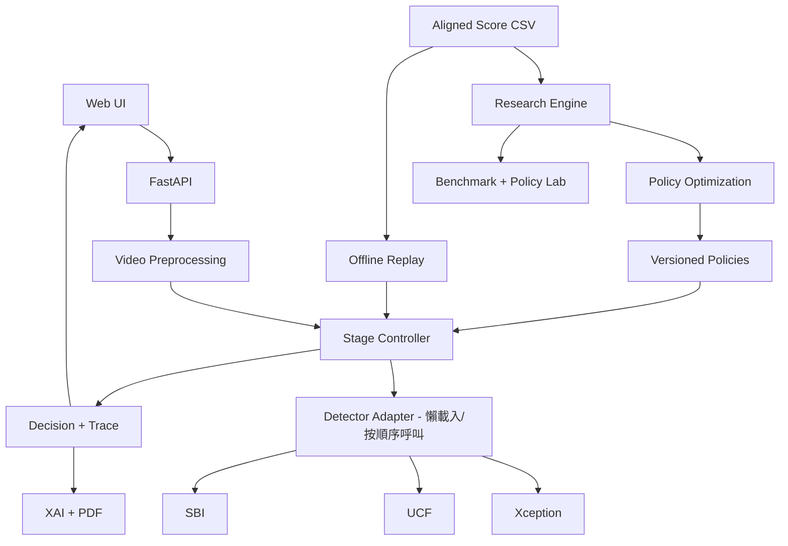

# 可解釋多階段 Deepfake 影片偵測系統
## Development Specification v1.0｜2026-10-21

**狀態：** 21 輪 Product Discovery 完成，進入 Phase-based Development。  
**人力：** 2 位開發者，每人每週 0–5 小時（團隊理論上限每週 10 人時）。  
**重要期限：** 10/30–11/6 海報；11/23 簡報與影片；12/18 專題發表。  
**部署前提：** 首選實驗室 GPU 單機，助教尚未確認可用性；CPU 開發與 Offline Replay 必須可獨立進行。

---

## 1. 專題目標與研究主張

建立結合 **Xception、UCF、SBI** 的影片 Deepfake Detection Framework，透過多階段執行、每階段雙門檻、Early Exit 與最終拒判，依場景選擇合適的 Detector 順序和門檻組合。

**Research Track：** 在明確的 FAR、FRR、Coverage 約束下，驗證最佳化 Cascade 是否能比 Always-Run Ensemble 減少平均推論成本；最低標準是可重現且公平的 Baseline 比較，即使沒有達到效率改善也應如實報告。研究主軸為多目標策略最佳化：Quality / Coverage / Cost。

**System Track：** 共用一套 Decision Engine，提供 Quick Scan、Forensic Analysis、Research Dashboard 三個介面。原則：Live Inference（實際 GPU 推論）和 Offline Replay（既有真實 Score CSV 重播）可共用決策核心，**但必須在畫面、API、報告標示資料來源**。

### 使用者與產品行為
- 一般使用者：單一上傳入口；預設 Quick Scan，輸出 Likely Real / Uncertain / Likely Fake、定性的風險程度、簡明文字理由。端到端 10 秒內是**目標**，尚非經驗證服務水準。
- 鑑識人員：從 Quick Scan 展開 Forensic Analysis；採較重視誤判風險的獨立 Policy；可查看門檻、各階段分數、決策理由、Grad-CAM、可疑時間軸和 PDF。30–60 秒是**目標**。
- 研究者／教授：Benchmark、Coverage–Risk 圖表、門檻與 Detector 排列模擬；互動式研究區只在 Validation Score CSV 調整，不得使用 Test Set 調參。
- 影片輸入：MVP 以本地 MP4 短影片、單一主要人臉為主；期末目標支援多人影片中選擇特定人臉。若多臉分析，結果適用範圍要明確標為「所選人物」。不納入社群 URL、音訊 Deepfake、案件管理。

## 2. 優先級與交付範圍

| 功能 | 11/23（簡報與影片） | 12/18（期末展示） |
|---|---|---|
| 網頁上傳影片、基本處理與錯誤回報 | **P0** | 強化 |
| 真實 Detector 影片推論 | **至少一個 P0**；第二個僅加分 | 目標三個，受限於權重與環境 |
| 統一 Detector Adapter、Stage Controller | **P0** | 完善 |
| 三元判斷、定性風險、Decision Trace | **P0** | 完善 |
| 三個 Detector 的 Offline Replay | **P0**（使用已存在真實分數） | 完善 |
| Benchmark 與必要 Baselines | **P0** | 完整實驗報告 |
| 單模型 Grad-CAM | **P1 嘗試，不阻塞 P0** | **P1** |
| 可疑時間軸、關鍵影格 | 延後 | **P1**；需有實際影格證據 |
| PDF 鑑識分析報告 | 延後 | **P1** |
| 互動式 Policy Lab | 基礎版可選 | **P1** |
| 多人選取與追蹤 | 延後 | **P1／可能縮減** |
| 雲端公開服務、社群連結、完整案件管理 | 不做 | **P2／本次範圍外** |

**範圍保護規則：** 先保證研究可重現、真實一模型推論、Decision Trace 與 11/23 影片交付。任何 P1 困難不得阻塞這四項。

## 3. 架構與模組責任



### 模組契約

**Detector Adapter：** 各 Repo 可維持自己的模型與預處理，但外部介面統一。需輸出 `detector_id`、`model_version`、`fake_score`、`score_direction`、`score_unit`、`preprocess_fingerprint`、`sampling_version`、`aggregation_version`、`inference_ms`；選填 `frame_scores` 與 XAI 所需影格資訊。任何 NaN、載入失敗或輸入不合法必須明確回錯，不得預設為真影片。

**Stage Controller：** 依 Policy 設定的 Detector 順序，**逐個呼叫**必要的模型；若 Stage 1 已 Early Exit，不得先將後續模型都跑完再假裝省成本。假設 Fake Score 越大越假：`score <= lower` → Likely Real；`score >= upper` → Likely Fake；中間則繼續下階段。全部模型已執行且仍未確定 → Uncertain（除非有另經驗證的 terminal rule）。門檻邊界規則需單元測試。模型失敗、沒有可用人臉、品質不足 → Unable to Analyze，與成功計算後的 Uncertain 分開。

**Policy：** `policy_id`、`version`、`mode`、`ordered_detectors`、各階段 `lower_threshold` / `upper_threshold`、`terminal_rule`、模型版本與分數合約。Quick / Forensic 使用不同設定；若 Forensic 需要不同的抽樣或預處理，不能直接重用不相容的舊分數。

**Decision Trace：** `request_id`、`analysis_mode`、`provenance (live_inference|offline_replay)`、`selected_face_id`（若適用）、`final_status`、`verdict`、`policy_id/version`、逐階段模型、分數、門檻、判斷、耗時、來源、錯誤與警告；若模型因 Early Exit 未執行也要標示。

**Research Engine：** score 校驗 → Baseline → 排序／門檻搜尋 → FAR、FRR、Coverage、Selective Risk、Cost 評估 → Pareto 過濾 → 凍結版本化 Policy。初期 Grid Search 足夠；是否實作 GP 最佳化不應成為 11/23 必備的前置依賴。

**Application：** 介面初期不強迫微服務、WebSocket、Docker 或雲端部署。使用 FastAPI + 輕量前端單機即可；必要時以背景任務與狀態查詢顯示真實進度，不需捏造百分比。影片上傳後應有檔案格式、容量、影片長度的安全限制（具體上限待 GPU 測試確定）。

### 建議 Repo 結構

```text
README.md
configs/policies/{quick.yaml,forensic.yaml}
src/deepfake/domain/{schemas.py,controller.py}
src/deepfake/detectors/{base.py,sbi.py,xception.py,ucf.py}
src/deepfake/preprocessing/
src/deepfake/research/{load_scores.py,baselines.py,search.py,metrics.py,replay.py}
src/deepfake/xai/
src/deepfake/api/
src/deepfake/reporting/
ui/
tests/{unit,integration,smoke}/
scripts/
docs/
artifacts/              # gitignore：原始影片、權重、輸出報告
```

## 4. Score CSV 與實驗合約

共同欄位至少包含 `sample_id, split, label, detector_id, fake_score, score_direction, model_version, preprocess_version, sampling_version, aggregation_version`。強烈建議補 `dataset_id, video_id, subject_id, inference_ms, cost_source, checkpoint_hash, prediction_unit`。

**Phase 0 不可跳過的檢查：**
- 三模型 Score CSV 的 `sample_id` 是否真正對應相同影片／受試者？是否有漏值、重複、標籤矛盾？
- CSV 是 frame-level 還是 video-level？若是影格分數，使用何種聚合規則？
- 三個分數是 `larger_is_faker` 還是反向？Raw score **不能直接當校正後的機率**。
- Train / Validation / Test 是否有影片或身分資料洩漏？模型門檻搜尋必須只用 Validation，最終 Test 不得迭代調參。
- 模型、前處理、抽影格、聚合版本是否記錄？否則 Research Policy 與 Live Model 的分數可能不可比。

### Baseline 與核心指標
必須比較：Xception Only、UCF Only、SBI Only、Always-Run Ensemble（明確定義融合規則）、Fixed-Order Cascade、Optimized Cascade。若 Baseline 與提出的方法的拒判機制不同，要報告差異或建立可比限制。

- `Coverage = 最終輸出 Real 或 Fake 的有效樣本數 / 全部有效樣本數`。
- `Selective Risk = 已決策且判錯的數量 / 已決策數量`；分母為零時為未定義，不可直接填 0。
- FAR（真實影片判成假）和 FRR（假影片判成真）必須寫明資料分母、決策樣本數、各類拒判數量。
- 成本分為：平均 Detector 呼叫數、依實測模型耗時推得的模擬 Cascade 成本、**真實**端到端延遲（平均、P50、P95）。不能把 Offline Replay 的估算稱為現場量測。
- 挑選政策：在 Validation 滿足預先定義的 FAR、FRR、Coverage 約束，產生 Pareto candidates；兩套情境 Policy 在最終測試前凍結。

## 5. 開發 Phase、任務與驗收

### Phase 0｜10/21–10/25｜可行性與契約凍結
**工作：** 向助教確認 GPU 使用權、OS / CUDA / VRAM、遠端登入／瀏覽器連線、是否可安裝依賴及執行常駐服務、11/23 和 12/18 可否使用；審核現有 Score CSV；調查 SBI、Xception、UCF 模型權重及推論入口（先 SBI、候補 Xception，依實測決定）；定義 Adapter／Policy／Trace Schema 與最小測試資料。

**驗收：** `docs/phase0_feasibility.md`、`docs/data_contract.md`、`docs/phase0_acceptance.md` 完成；明確選定第一個試跑 Detector，列出硬體與權重阻礙。若 GPU 未取得，CPU 可執行 Replay／單元測試不得受阻。

### Phase 1｜10/26–11/01｜Research Engine 與 Stage Controller
**依賴：** Phase 0 的分數合約、資料切分、Policy 形式。  
**工作：** 實作 CSV 讀取與驗證；基於測試 Stub 建立 Lazy Stage Controller、三元決策、拒判、完整 Trace；Baselines、門檻／順序 Grid Search、Coverage、Selective Risk、FAR、FRR；離線 Replay CLI；整理海報所需、確實跑出的研究圖表。

**驗收：** 相同樣本＋Policy 100% 可重現輸出；門檻邊界、無效分數、排序、Uncertain、模型失敗皆有測試；研究結果附樣本數、拒判數與資料來源。海報在 11/6 前按規定繳交。

### Phase 2｜11/02–11/12｜真實推論與 Web MVP
**依賴：** Adapter Contract；第一個 Detector 權重＋可用 GPU；Phase 1 決策核心。  
**工作：** 接入至少一個真實 Detector、模型所需的人臉擷取／影格抽樣、錯誤處理；建 FastAPI（建議 `POST /analyses`、`GET /analyses/{id}`、`GET /health`）和基礎 Web UI；串接 Stage Controller；實作可見的來源標記與模型耗時紀錄。

**驗收：** 使用者實際上傳允許的 MP4，得到真實模型輸出、三元決策與 Trace；不合法檔案、無人臉和推論失敗時顯示正確錯誤。**不能把離線三模型 Replay 冒充即時三模型推論**。

### Phase 3｜11/13–11/23｜第一版整合、XAI 與繳交
**依賴：** Phase 1、Phase 2；Grad-CAM 另依賴可取得梯度的真實模型。  
**工作：** 完成 Quick / Forensic 頁面切換與可重現操作；Offline Replay 演示三模型階段性結果；嘗試第一個真實 Detector 的 Grad-CAM；整合研究 Benchmark；撰寫 Demo 腳本與簡報，錄製示範影片。

**停損：** 若 Grad-CAM 或第二個模型阻礙主要操作，立刻延後，不影響 P0。**11/20 功能凍結**，餘下完成錄影與測試。  
**驗收：** 依第 7 節 Demo 流程不修改輸出即可重現，11/23 準時提交簡報與影片。

### Phase 4｜11/24–12/08｜Forensic 與進階研究功能
**依賴：** 穩定的 Trace、第一個模型、研究資料與 Policy；第二／第三模型需各自驗證權重和前處理。  
**優先順序：** (1) 額外 Detector 的真實 Adapter (2) 實際影格分數時間軸與關鍵影格 (3) Grad-CAM (4) PDF（包含影片 SHA-256、政策、模型版本、來源與警語）(5) Validation Policy Lab (6) 多人選取／追蹤。

**驗收：** 每完成一項就有獨立 Smoke Test；若時間不足，保留可用功能，不以「三模型／多人物全部完成」作為不可調整的硬性條件。

### Phase 5｜12/09–12/18｜測試、凍結與發表
**依賴：** Phase 4 已完成的可運行功能，不強迫等待全部 P1。  
**工作：** 凍結兩種 Policy；只在這時執行最後獨立 Test Set 報告；對照 Baselines 和條件限制說明改善幅度／不足；檢驗 API、錯誤輸入、GPU OOM／Timeout、權重缺失、低品質人臉、多人臉選擇；準備現場 Live Demo 與備援 Replay／錄影。

**驗收：** 12/18 現場可展示一致結果；效能指標區分測量與估計；研究圖表具可重現操作說明；明確列出未完成的延伸功能。

## 6. 雙人分工與依賴管理

**Developer A — Research & Decision Engine：** CSV 資料稽核、Dataset Split、Stage Controller、Baseline、Grid Search、Policy Optimization、Research Dashboard 資料與測試。

**Developer B — Inference & Application：** Repo/Checkpoint 評估、第一個真實 Detector、影片前處理、API、Web UI、部署、Grad-CAM 與報告。

**雙方共同負責：** Phase 0 Schema、整合 Smoke Test、研究指標說明、11/23 錄影、12/18 展示。

**依賴序列：** 資料合約 → Controller/Replay → Benchmarks；Adapter Contract + GPU/Checkpoint → 真實模型 → Web Vertical Slice → Demo；Grad-CAM 依賴真實模型，PDF 依賴 Trace，影片時間軸依賴可靠的 Frame-level score，多人選取依賴追蹤與身份一致性。

**GPU 延遲時的備援：** 開發者不等待 GPU 才開始工作；先完成 CPU 單元測試、Replay、研究指標、Web Mock（清楚標為 Stub）以及 Demo UI。絕不將 Mock 分數寫入正式研究報告。

## 7. 11/23 Demo Acceptance Test

1. 開啟 Web UI，上傳短 MP4 且可辨識人臉。
2. 系統顯示實際進度／階段與至少一個真實模型的推論。
3. 呈現 Likely Real / Uncertain / Likely Fake 或妥善顯示 Unable to Analyze，附定性風險說明及判斷限制。
4. 開啟 Decision Trace，看到實際執行的 Detector、分數、雙門檻、退出／拒判原因、來源。
5. 切換**清楚標示的 Offline Replay**，以對齊的真實 Score CSV 展示三個 Detector 的 Stage／Early Exit 變化。
6. 顯示可重現的 Baseline 與 Benchmark；Grad-CAM 在真實可用時展示，若未完成如實說明並列為期末擴充。

## 8. 錯誤、安全與 XAI 解釋限制

- **Completed / Uncertain / Unable to Analyze 必須區分。** 前者兩者代表執行完成，後者代表影片／模型無法有效分析。
- 不得把輸出的 Fake Score 當作 `92% 影片必定是假的`。若未做校正與驗證，只能稱模型分數與由策略決定的定性風險等級。
- Grad-CAM 代表模型的關注區域，不能用作篡改區域的鑑識證明；時間軸也不可直接以 Grad-CAM 熱度當作已驗證的假造程度。
- 限制檔案大小、類型、解碼與推論時間；影片與人臉裁切預設本地最小留存，不把權重、原始影片、機密或登入憑證 Commit 到 GitHub。
- 影片摘要的判斷範圍要明確，尤其多人影片的特定人物選擇。

## 9. Codex 階段式開發規範

1. Codex 每次只執行被明確授權的 Phase，先讀 Spec、盤點現有 Repo 與可執行環境。
2. 先列本 Phase 的工作計畫、預計修改檔案、測試方式、已知風險；先建立最低成本且可驗證的垂直切片。
3. CPU 上可執行的單元測試優先；未獲許可不要大量下載 Dataset／Checkpoint、訓練模型或修改遠端 GPU 環境。
4. 每個 Phase 結束需報告變更檔案、測試命令、實際測試結果、無法驗證的事項、風險與下一步。
5. 禁止憑空建立模型權重、分數與實驗結果；禁止把 Stub Mock 偽裝成 Live Inference。
6. 環境差異使用 Config／ENV 注入，避免硬寫本機絕對路徑；不同模型可各自使用隔離環境，但以 Adapter 契約串接。
7. 未通過 Phase Gate 或未獲明確指示，**不得自動進入下個 Phase**。

### Phase 0 可直接貼給 Codex 的 Prompt

```text
你是 Explainable Multi-Stage Deepfake Detection Framework 的實作 Agent。
請以 deepfake_專題開發規格_v1.0.md 為唯一的產品需求基準，
本次只執行 Phase 0，不開始 Phase 1。

1. 先唯讀盤點目前 Repo、Python/OS、現有配置與可取得的模型權重。
2. 檢查已有的 Xception/UCF/SBI Score CSV：欄位、sample/video ID 對齊、
   label 定義、score_direction、per-frame/per-video 單位、資料切分。
   如果檔案不存在，清楚列為 blocker，不得編造資料。
3. 確認每個 Detector 的影片推論入口、相依套件及環境問題。
   優先調查 SBI，候補 Xception；UCF 的 checkpoint 和輸出介面另列風險。
4. 提出最低可行的 DetectorOutput、Policy、DecisionTrace Schema。
5. 輸出 docs/phase0_feasibility.md、docs/data_contract.md、
   docs/phase0_acceptance.md，並給出第一個 Detector 的選擇建議。
6. 可以建立必要的輕量 CPU 測試，但不可下載大型資料集、
   不可執行訓練、不可擅自修改遠端 GPU 主機。
7. 執行可用測試，明列實際測試命令、通過/未通過結果與剩餘 blocker。

完成後停止，等待我確認 Phase 0 的驗收結果再開始下一個 Phase。
```

## 10. 未決事項（本次會議需確認或委派）

- **GPU 主機：** 使用權限、遠端瀏覽器連線、OS / CUDA / VRAM、權重可否存放、期末可否開機。
- **第一個 Detector：** SBI 優先作可行性驗證，但尚未確定權重／環境可執行。
- **Score CSV：** 是否為同批樣本、影片層級、資料切分、方向與版本相容。
- **Quick / Forensic 的具體 FAR、FRR、Coverage 約束：** 等 Baseline 統計確認，不任意指定數字。
- **資料上傳限制：** 正式影片秒數與容量上限，依模型測試與儲存資源訂定。
- **12/18 P1 是否全做：** Phase 3 後依剩餘工時重新排列優先度。

### 版本管理原則
本文件 v1.0 為已凍結的需求基準。新增 P0 工作需明確換出其他同等工作量，或取得額外人力。每週以 Phase Gate 與實際執行證據為依據更新，不用「已經寫好程式」代替「已通過驗收」。
