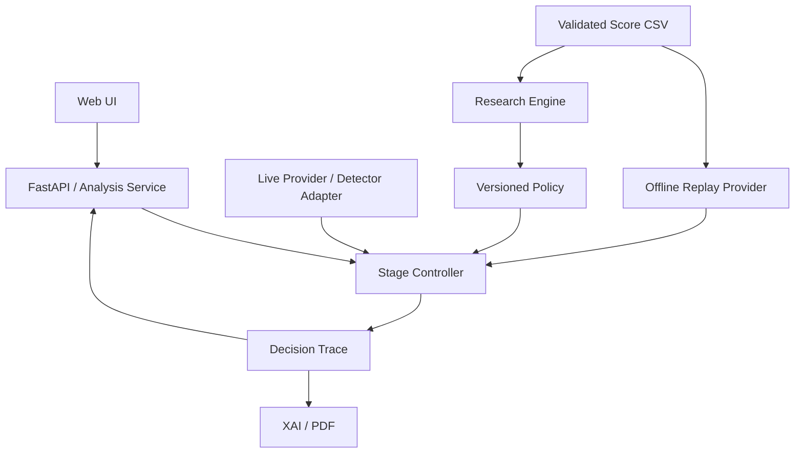

# Explainable Multi-Stage Deepfake Detection Framework — Technical Specification

版本：1.1｜日期：2026-10-21（Asia/Taipei）｜狀態：Awaiting Review，尚未授權 To Tickets 或 Implementation。

需求基準：Repo 的 `Deepfake_專題開發規格_v1.0.md`（21 輪 Product Discovery 已完成）。本文件將已確認需求轉為技術合約，不重新開啟產品訪談。需求文件優先於本文件；新增技術選擇皆須通過本文件列出的驗收。

初版來源快照：Git HEAD `8ae678121c1db4a25681cd88fb6835a5c3e1f5d6`；需求文件 SHA-256 `cd271993f33671a103949fa12bf0e3a01d08573e4133e00a677d8f8bb776058a`。需求文件於盤點時為未追蹤檔案，因此 HEAD 本身不包含該需求，須連同上述雜湊辨識版本。

初版及本次修訂僅新增／更新規格文件及發布／同步規格 Issue；不建立實作 tickets、不修改既有應用程式碼、不安裝套件、不下載模型或資料集、不操作遠端 GPU。

## Problem Statement

一般使用者需要對短影片取得可理解的真偽傾向；鑑識人員需要知道判斷用了哪些模型、哪些門檻，以及哪些證據仍不足。研究者需要以一致資料、拒判規則與成本定義，比較 Xception、UCF、SBI 的多階段決策與 Always-Run Ensemble。

目前 Repo 只有需求文件、README 與 Python 類型的忽略規則，尚無上述系統。若先做展示頁或分別實作 Live／Replay 邏輯，容易出現展示與研究判斷不一致、預先執行全部模型卻宣稱 Early Exit、將離線估算冒充現場效能等問題。

團隊只有兩位開發者，每人每週 0–5 小時；總計 10 人時是上限，不是保證。實驗室 GPU、三個模型的可執行權重及三模型對齊分數尚未確認。本規格以可重現研究、單一真實模型垂直流程、完整 Decision Trace 和 11/23 交付為優先，不以 P1 功能阻塞 P0。

## Solution

建立單機、模組化的 Python 系統：Research Engine 校驗分數並選出版本化 Policy；Stage Controller 依 Policy 惰性取得 DetectorOutput，以雙門檻決定提前退出或繼續，產生 DecisionTrace。Live Inference 使用真實 Detector Adapter，Offline Replay 使用唯讀分數提供者，兩者共用控制器與判斷規則。

FastAPI 與輕量 Web UI 提供預設 Quick Scan、獨立 Policy 的 Forensic Analysis，以及研究結果展示。所有結果明示 Live／Replay、模式、適用人物、版本與限制。不能分析與成功計算但拒判是兩種狀態。XAI 與 PDF 消費既有分析證據，作為可獨立交付的擴充。

研究成功的最低標準是公平、可重現的 Baseline 報告；若最佳化 Cascade 未改善成本或無可行 Policy，也必須保留結果。Quick 10 秒內及 Forensic 30–60 秒只是待量測目標，不是現有服務保證。

## User Stories

1. 身為一般使用者，我希望從單一入口上傳本地 MP4，以便開始分析短影片。
2. 身為一般使用者，我希望預設使用 Quick Scan，以便以最少操作取得判斷。
3. 身為一般使用者，我希望看到真實處理階段，以便分辨分析中、完成與失敗。
4. 身為一般使用者，我希望看到 Likely Real、Likely Fake 或 Uncertain，以便理解系統的真偽傾向與保留判斷。
5. 身為一般使用者，我希望不能分析時明確顯示 Unable to Analyze，以便避免將失敗誤認為真實或拒判。
6. 身為一般使用者，我希望看到定性風險與簡明理由，以便理解結果而不誤讀為保證機率。
7. 身為一般使用者，我希望格式、容量及長度錯誤有可理解的提示，以便修正輸入。
8. 身為一般使用者，我希望知道結果來自 Live Inference 或 Offline Replay，以便理解其證據來源。
9. 身為一般使用者，我希望影片和人臉資料只在本地最小留存，以便減少資料外流。
10. 身為鑑識人員，我希望從 Quick 切換到 Forensic Analysis，以便採用獨立且重視誤判限制的 Policy。
11. 身為鑑識人員，我希望看到所用 Policy 的版本、順序和雙門檻，以便重建判斷過程。
12. 身為鑑識人員，我希望看到各階段實際執行、跳過或失敗的原因，以便檢查 Early Exit 是否真的節省工作。
13. 身為鑑識人員，我希望看到模型分數及其單位，以便避免將 raw score 當作校正機率。
14. 身為鑑識人員，我希望結果明示所選人物，以便避免將單一人臉判定套用到整段多人影片。
15. 身為鑑識人員，我希望在有真實影格證據時查看時間軸與關鍵影格，以便定位需要人工檢查的片段。
16. 身為鑑識人員，我希望在模型支援時查看 Grad-CAM，以便了解模型關注區域。
17. 身為鑑識人員，我希望看到 XAI 的限制與不可用原因，以便避免把關注區域當成篡改證明。
18. 身為鑑識人員，我希望在 PDF 功能交付時匯出來源、影片雜湊、模型、Policy 和警語，以便保留分析紀錄。
19. 身為研究者，我希望在 CPU 上重播真實 Score CSV，以便不依賴 GPU 開發決策研究。
20. 身為研究者，我希望匯入時拒絕重複、缺漏及矛盾標籤，以便建立公平的樣本集合。
21. 身為研究者，我希望確認三個 Detector 對應同一批影片及相同分析範圍，以便比較 Cascade 與 Baselines。
22. 身為研究者，我希望分數方向、抽樣、預處理及聚合版本被記錄，以便判定 Policy 是否可移轉到 Live。
23. 身為研究者，我希望只以 Validation 搜尋門檻及排序，以便保護最終 Test 的獨立性。
24. 身為研究者，我希望比較三個 Single Detector、Always-Run Ensemble、Fixed-Order 及 Optimized Cascade，以便判斷方法的實際貢獻。
25. 身為研究者，我希望看到 FAR、FRR、Coverage、Selective Risk 的分子分母與拒判數，以便正確解讀結果。
26. 身為研究者，我希望區分 Detector 呼叫數、估計成本與實測端到端延遲，以便避免混淆成本證據。
27. 身為研究者，我希望保存搜尋空間、資料雜湊及選擇規則，以便重現 Policy 選擇。
28. 身為研究者，我希望看到 Pareto 候選與無可行解狀態，以便如實報告取捨。
29. 身為研究者，我希望最終測試前凍結 Quick／Forensic Policy，以便避免依 Test 反覆調參。
30. 身為研究者，我希望 Policy Lab 只接受 Validation，以便保持互動探索的資料邊界。
31. 身為開發者，我希望共用同一個分析與決策入口，以便用最少測試邊界驗證 Live／Replay 一致性。
32. 身為開發者，我希望後續模型在 Early Exit 後不載入、不呼叫，以便確實控制 GPU 資源與成本。
33. 身為開發者，我希望模型缺失、OOM、Timeout、NaN 有穩定錯誤碼，以便診斷並維持服務狀態一致。
34. 身為開發者，我希望 CPU 契約測試不匯入模型框架或下載權重，以便在一般開發機執行。
35. 身為開發者，我希望每個額外 Detector 與 P1 功能有獨立 Smoke Test，以便逐項驗收、逐項延後。
36. 身為專題評審，我希望現場 Live、Replay 和錄影清楚區分，以便評估已完成能力。
37. 身為專題團隊，我希望在 11/20 凍結 MVP 並交付 11/23 簡報影片，以便保護交付時間。
38. 身為專題團隊，我希望在 12/18 提供可重現報告與已驗收功能清單，以便清楚說明成果及未完成範圍。

## Implementation Decisions

### 1. 證據、規範性與現況

「必須」為驗收要求；「技術決定」為本規格選擇的最小方案；「暫定」為需 Phase 0／量測確認的假設。未確認項目不得在實作或報告中被描述為現有能力。

| 唯讀盤點項目 | 2026-10-21 觀察 | 技術意涵 |
|---|---|---|
| Repo | 初次盤點僅 README 與忽略規則；需求／規格現已由使用者提交為 2f4133f | Cascadeguard 無既有應用、ADR 或測試；外部 Repo 已確認有可沿用的資料集推論、聚合、雙門檻與測試先例；產品用語仍以需求基準為準 |
| 資料與模型 | 本 Repo 中無 CSV、資料集、權重、Detector 推論程式；使用者補充 score.csv、權重、推論入口位於另一個以 DeepfakeBench 為基底修改的 Repo | 外部原始碼與設定已唯讀檢查；此 checkout（排除 .git／.venv）未找到 CSV／權重實體，來源位置仍待確認；未執行模型，不能聲稱三模型 Live 可用 |
| 依賴設定 | 無套件清單、lockfile、CI、部署設定 | 本文依賴為建議選型，未驗證版本相容性 |
| 本機 | Windows、Python 3.11.7；Git、Node 可用 | CPU 核心可先以 Python 3.11 驗證；不要求 Node 建置流程 |
| 本機 Python | 未找到 FastAPI、Pydantic、PyTorch、pytest、NumPy、pandas、OpenCV | 本次無可執行應用測試；未安裝任何依賴 |
| 本機 GPU | NVIDIA GeForce MX350，2048 MiB；driver 516.40 | 僅硬體查詢；未驗證 CUDA runtime 或模型能力，不作部署保證 |
| 實驗室 | 未連線、未檢查 OS／CUDA／VRAM／權限 | 不將其他專案硬體或既有記憶套用到本專題 |
| Tracker | 使用者確認 GitHub Issues 與 ready-for-agent | 本 Issue 是規格容器，標籤不構成實作授權 |

### 2. 模組責任與依賴方向

採單機模組化應用、單一 API process。CPU 核心與 API 使用獨立輕量環境；既有 DeepfakeBench 模型執行環境先保留，採同機受控子程序與 JSON 合約作整合預設，以隔離 registry、全域路徑及依賴副作用。若後續相容性驗證通過，可簡化為同 process Adapter；不預建 HTTP 模型微服務。

外部模型來源保留為獨立 checkout，固定可辨識 revision 並記錄未提交修改；以設定引用 checkout、Python executable、權重及分數位置，不整庫搬入 Cascadeguard、不先引入 submodule。既有模型 forward、影片 ID wrapper、分數聚合與資料子集能力可作 Adapter 來源；既有兩階段 CLI 是資料集評估先例，不直接當作新系統的控制器。實作時在 Cascadeguard 建立最薄的橋接，子程序每次只處理 Controller 指定的一個 Detector，回傳原始影格證據與版本化輸出；不呼叫會自行完成兩階段的 CLI 冒充惰性 Adapter。模型初始化／推論限制不等於禁止 import Python class，但現有 eager registry 的模組依賴不能進 CPU 核心。外部原始碼可讀不表示權重可載入或影片流程已跑通。

圖中的 Provider → Controller 表示提供分數；實際執行由 Controller 按序要求 Provider，Provider 不主動預跑後續 Detector。

| 模組 | 責任及可觀測輸出 | 不負責 |
|---|---|---|
| Research Engine | CSV 校驗、cohort、Baseline、Validation Grid Search、指標、Pareto、Policy 凍結、可重現報告 | 上傳影片、訓練 Detector、執行 Grad-CAM |
| Detector Adapter / Live Provider | 相依初始化、模型專用預處理、抽樣、聚合、分數方向正規化、計時、錯誤轉換 | 決定門檻、排序、最終 verdict |
| Replay Provider | 按樣本和合約查詢已校驗分數，回傳同型 DetectorOutput；保留原始來源 | 呼叫模型、補造缺分數、宣稱 GPU 耗時 |
| Stage Controller | 驗證 Policy、逐階段取得分數、雙門檻、Early Exit、失敗即停、完整 Trace | HTTP、檔案上傳、XAI、模型實作 |
| Decision Trace | 記錄可驗證的決策事實與 Policy 快照，供 UI／報告共用 | 隱藏 fallback、推測未執行模型分數 |
| Analysis Service / FastAPI | 輸入校驗、檔案生命週期、工作狀態、Policy 選擇、呼叫控制器、序列化 | 重寫雙門檻判斷、依前端輸入任意載入權重 |
| Web UI | 單一上傳、Quick／Forensic、來源標籤、進度、判斷、Trace、研究結果 | 自行算 verdict 或調用模型 |
| XAI / Reporting | 使用已執行模型與影格證據產生解釋／PDF，保留來源和警語 | 修改 verdict、默默跑完所有模型 |

### 3. 共用分析入口與 Live／Replay

主要測試入口是 Analysis Service 的「分析請求 + 已解析 Policy + 分數提供者 → AnalysisResult／DecisionTrace」。Controller 只依賴單一取分契約：要求指定 Detector 對指定樣本及分析範圍回傳 DetectorOutput，或回傳具錯誤碼的失敗。Live 與 Replay 都必須走這個入口；研究批次逐樣本呼叫同一控制器。

現有外部資料集推論 helper 會搬移 label tensor，這是評估流程的介面需求，不代表產品有真實標籤。新 Live 橋接必須驗證三模型 inference 分支不以 ground truth 路由或計分；必要的結構性 placeholder 需標示非真值，禁止混入研究標籤或結果。Live 的輸入是已通過校驗的影片與人物範圍；Replay 的輸入是資料集、split、sample_id 及分數合約。標籤只提供 Research Engine 算指標，不傳給控制器。不得依 label 決定門檻、排序或退出。

一致性定義：在 Policy、分析範圍與 DetectorOutput 數值及合約相同時，兩個 Provider 產生相同 verdict、stage action、退出位置及跳過原因。request_id、時間戳、來源、實測延遲自然不同，不要求整份 JSON 位元組相同。真實模型的非確定性另由模型證據記錄，不能承諾跨硬體 bitwise 一致。

Replay 可以在匯入時將 CSV 載入記憶體，但 Trace 必須稱後續階段「未查詢／未使用離線分數」，不能稱「現場省去 GPU 推論」。Live 在需要某階段時才載入和呼叫其模型；首階段退出後，後續模型初始化與推論次數均為零。

### 4. 核心資料合約

所有合約帶 `schema_version`，第一版為 `1`。JSON 使用 UTF-8，數值不可 NaN／Infinity，時間 UTC ISO 8601，耗時為非負毫秒。以 Pydantic 驗證邊界資料，核心不得依賴 GPU 套件。未知 schema major version、必要欄位遺漏或不相容 fingerprint 必須拒絕。以下是欄位規格，不代表已存在的程式型別。

#### 4.1 DetectorOutput

DetectorOutput 只代表成功結果；失敗使用結構化 AnalysisError，不能以 0、0.5 或 null score 冒充成功。

| 欄位 | 型別／必要性 | 規則 |
|---|---|---|
| schema_version | integer，必填 | 1 |
| detector_id | string，必填 | xception、ucf、sbi；只能解析已註冊 Adapter |
| sample_id | string，必填 | 分析單位的穩定 ID；跨模型相同 |
| model_version / checkpoint_hash | string／string 或 null，必填 | Live 必有版本與實際權重 SHA-256；Replay 舊資料缺 hash 時明確 null、限探索研究並警告，禁止宣稱正式合約／Live 相容 |
| fake_score | finite float，必填 | 正規化後，越大越假；未做機率校正 |
| score_direction | enum，必填 | Controller 僅接受 larger_is_faker |
| score_unit | enum，必填 | unit_interval、logit 或 raw；每模型門檻使用相同單位 |
| score_transform_version | string，必填 | identity／已登錄方向轉換版本，與 Policy 匹配 |
| preprocess_version / preprocess_fingerprint | string，必填 | 前者識別演算法版本，後者識別具體設定；兩者皆不可憑空填成已知 |
| sampling_version / aggregation_version | string，必填 | 包含可重建抽樣、聚合的設定指紋 |
| prediction_unit | enum，必填 | 第一版 Controller 僅 video；frame 級需先聚合 |
| selected_face_id / analysis_scope | string 或 null／string，必填 | single_primary_face 或 selected_face；單主要臉也需穩定範圍描述 |
| inference_ms | finite float 或 null，必填 | Live 為實測本次 Adapter predict 耗時；Replay 為原始實測值或 null |
| timing_source / timing_profile_id | enum／string 或 null，必填 | measured_live、recorded_measurement、unavailable；profile 記硬體、batch、邊界及冷暖機 |
| frame_scores | array，可選 | 每筆含 frame_index、timestamp_ms、face_id、score、score_unit；不得把影片單一分數複製成時間軸 |
| evidence_refs / warnings | array，必填可空 | 本地可解析的受控 evidence ID 與警告，不能暴露任意檔案路徑 |

分數方向轉換由 Adapter／CSV 匯入層負責且保留原值及原方向供稽核。原分數越小越假時，unit_interval 可採 1−raw；logit／raw 採 −raw，單位和 transform version 必須一致。轉換是方向統一，不是 calibration；不對 raw 任意 min-max 壓成機率。unit_interval 必須在 [0,1]；其他單位只要求有限數值。

已確認外部 Xception／UCF 使用 256 解析度、32 個 test frames、mean/std=[0.5,0.5,0.5]，其既有 Cascade 先驗證共享輸入再對同一 Dataset 建子集。SBI 設定雖同為 256／32 frames，mean/std 不同且啟用 landmark，因此不能直接接入此共享 tensor 契約；需獨立正規化／必要欄位，並驗證推論分支是否實際需要 landmark。Live 預處理不得為三模型強迫共用不相容的人臉 crop 或輸入尺寸。可共用影片 metadata／解碼快取；模型專用抽樣與 crop 由 Adapter 定義並指紋化。新整合的 frame 模型預設候選為固定均勻時間抽樣及有效影格分數算術平均，但僅在 upstream 檢查與 smoke 通過後凍結；不覆寫既有 CSV 的原聚合方式。臉品質最低值、抽樣數及主要人物選取規則均是 Phase 0 待定設定；未凍結前不得發布相容的正式 Policy。

#### 4.2 Policy

| 欄位 | 型別／內容 | 不變條件 |
|---|---|---|
| policy_id / version / schema_version | string／string／integer | 版本不可原地覆寫；發布後唯讀 |
| mode | quick 或 forensic | 兩模式獨立 Policy，不能只換 UI 名稱 |
| ordered_detectors | 非空且不重複的 detector_id list | 支援一至三模型；MVP Live 可為單模型，Replay 可為三模型 |
| stages | 與順序一對一的 list | 每筆含 detector_id、lower_threshold、upper_threshold、expected_score_contract |
| expected_score_contract | 版本、權重、方向、單位、轉換、預處理、抽樣、聚合、prediction_unit、scope 設定 | 逐欄相容才可使用分數；不能僅比 detector_id |
| terminal_rule | enum | v1 僅 abstain；最後分數位於雙門檻內即 Uncertain |
| constraints | max_far、max_frr、min_coverage 及 metric_definition_version | 正式研究選擇前必填；數字目前 TBD，不杜撰 |
| selection_metadata | validation cohort hash、search config hash、baseline 定義、cost profile、tie-break、資料血緣 | 可重建選擇；禁止使用 Test 選 Policy |
| policy_hash / lifecycle / live_eligible | hash／draft 或 frozen／boolean | hash 根據不含自身的 canonical payload；live_eligible 必須有實際合約相容證據 |

每階段須 `lower_threshold < upper_threshold`，皆有限且符合 score_unit 範圍；嚴禁相等造成雙重命中。Policy 驗證在開始分析前完成；無效 Policy 不呼叫任何 Detector。實作不提供未驗證的 terminal 強制二元分類。

正式 Quick／Forensic 限制由 Baseline 證據和團隊技術審查凍結，不重新討論已確認產品方向。Forensic 的目標較重視誤判風險；沒有足夠資料或可行候選時顯示未驗證／不可用，不宣稱已更可靠。開發中的 draft Policy 可用於測試展示，但必須標示 experimental，不能冒充研究定稿。

#### 4.3 DecisionTrace 與 AnalysisResult

AnalysisResult 包含工作狀態、結果及唯一一份 DecisionTrace；UI 與 PDF 不自行再算判斷。

| Trace 欄位 | 規則 |
|---|---|
| schema_version、request_id、created_at | 唯一請求、契約版本、UTC 時間 |
| analysis_mode、provenance | quick／forensic；live_inference／offline_replay；測試 Stub 另設非正式 test_stub 標記，不混入研究 |
| sample_id、dataset_id、split、input_sha256、selected_face_id、analysis_scope | Live 必有 input_sha256；Replay 保留 dataset／split，缺原始影片 hash 則 null 並註明；人物適用範圍必有 |
| policy_id、policy_version、policy_hash、policy_snapshot | 保存實際解析的順序、門檻及 score contract，避免未來改設定而無法重建 |
| final_status | completed 或 unable_to_analyze；queued／running 屬工作狀態，不與 verdict 混用 |
| verdict | completed 時為 likely_real、likely_fake、uncertain；unable_to_analyze 時必為 null |
| qualitative_risk、reason_code、reason_text | likely_real→low、likely_fake→high、uncertain→indeterminate；失敗→unavailable；僅描述模型判斷的偽造疑慮 |
| stages | 每個 planned Detector 一筆，保留 stage_index、score contract、實際分數或 null、門檻、action、來源、耗時、error／warnings |
| stage status／action | status 為 executed、failed、skipped；action 為 exit_real、exit_fake、continue、abstain、error、skip_early_exit 或 skip_prior_error |
| timing | wall_ms、preprocess_ms、model_load_ms、adapter_inference_ms、xai_ms（若適用）、simulated_cost_ms 各自記錄；缺測量為 null |
| warnings／error／evidence_refs | 失敗保留先前已完成階段；跳過 stage 無 score／inference_ms，不能填 0 分 |

最後階段命中門檻時仍可輸出 Real／Fake；全部有效階段都在門檻中間才 abstain。失敗與拒判在 API、UI、Trace、統計中皆分開。

#### 4.4 Score CSV Schema 與 cohort

採 UTF-8 long-form CSV；標準化後每列代表「一個影片分析單位 × 一個 Detector」的有效成功分數，schema version 在 companion manifest 指定。manifest 保存資料來源、原檔 SHA-256、匯入版本、label mapping、合約版本、時間量測 profile、split／人物規則及缺漏稽核。

| 欄位 | 必要性及限制 |
|---|---|
| sample_id、split、label、detector_id、fake_score、score_direction、model_version、preprocess_version、sampling_version、aggregation_version | 基準必填；split=train／validation／test，label=real／fake（來源數值需明確映射） |
| dataset_id、video_id、prediction_unit、score_unit、score_transform_version、analysis_scope、preprocess_fingerprint | 標準化內部格式必填，可由有證據的 manifest 補入；v1 prediction_unit=video |
| subject_id、selected_face_id、checkpoint_hash | 可空但需揭露；缺 subject_id 只能稱 identity leakage 未驗證；缺權重證據禁止 Live policy 移轉 |
| inference_ms、cost_source、timing_profile_id | 可空；若有耗時必須有來源／profile；空值不補成零 |

唯一鍵為 dataset_id + sample_id + detector_id；每個 sample_id 明確映射 video_id 與人物範圍。多人物擴充時不同人物必須使用不同 sample_id，禁止同鍵混入多臉。每 Detector 在同一實驗只允許一個凍結 score contract；不同合約另建實驗，不混列。

匯入分兩步：稽核來源並輸出問題清單；建立凍結 cohort。跨模型必須以 ID join，不能依列順序對齊。重複鍵、標籤矛盾、split 矛盾、無效分數、無法證明相同影片或人物範圍均阻止正式 benchmark。缺模型樣本預設阻止執行；若明確選用共同完整交集，需保存排除清單、原因、每類數量，且所有方法使用相同交集。禁止 silent inner join 或逐方法 dropna。

已確認外部現有 exporter 產生 image_path、label、probability 三欄的影格級 predictions CSV；使用者所指 score.csv 尚未取得，不能假設就是此格式。既有 CSV 缺 video_name、split、detector_id、checkpoint、預處理與時間證據，匯入需要原 dataset JSON／當次設定建立 image_path→完整 video identity 對照及 companion manifest。video_name 是 opaque ID，不以猜測路徑片段代替；dataset_id 應作 namespace，不能跨資料集假定 video_name 全球唯一。若無法還原 ID 與聚合血緣，正式 Replay gate 仍 blocked。frame-level 原資料必須另經可重現聚合，保留 frame ID、時間與有效影格數；未確認原聚合規則不能假設已是 video-level。Metadata 缺失可做探索，但不能聲稱正式三模型驗收完成。

分割至少以影片／原始來源群組隔離，衍生偽造版本及影格不得跨 split；有 subject_id 時檢查身分隔離。既有模型的訓練集重疊風險亦需揭露，未知不能稱無洩漏。Train 不用於門檻搜尋；Validation 用於搜尋與凍結；Test 在最終評估開封。

### 5. 雙門檻與狀態轉移

1. 校驗完整 Policy、source、scope 與輸入；無效即返回錯誤，不取分。
2. 按 ordered_detectors 取得當前 DetectorOutput，驗證版本與 score contract。
3. `fake_score <= lower_threshold`：輸出 Likely Real，記 exit_real，跳過所有後續階段。
4. `fake_score >= upper_threshold`：輸出 Likely Fake，記 exit_fake，跳過所有後續階段。
5. 嚴格介於兩門檻：繼續；若為末階段，completed + uncertain，記 abstain。
6. 任一必要階段載入／計算／合約驗證失敗：unable_to_analyze + null verdict；保留既有 Trace，後續記 skip_prior_error；不跳過失敗模型繼續猜測，不自動換 Policy。

比較使用未四捨五入的有限數值；顯示四捨五入不參與決策。不引入 epsilon 偷改邊界。前階段在模糊區的分數不平均帶入後階段；每階段使用當前模型分數及其門檻。不同模型 raw score 不直接互相比大小。

### 6. 研究指標與公平比較

#### 6.1 計數及分母

採需求基準的命名：FAR=真實影片誤判為假；FRR=假影片誤判為真。外部既有 metrics 的命名恰好相反：legacy FAR=假判真，legacy FRR=真判假。匯入舊報告時必須記 legacy_metric_definition 並按公式轉接，不能原封不動搬 far／frr 欄。新系統維持已確認需求的定義，報告必須同時列中文及公式。

在固定完整有效 cohort 中，令 R、F 為真實／偽造數，N=R+F。Rr／Rf／Ru 為真實樣本被判真／假／拒判；Fr／Ff／Fu 為偽造樣本被判真／假／拒判。D=Rr+Rf+Fr+Ff，E=Rf+Fr。

| 指標 | v1 定義 |
|---|---|
| Coverage | D / N |
| Selective Risk | E / D |
| FAR（主要約束） | Rf / R |
| FRR（主要約束） | Fr / F |
| Real／Fake Coverage | (Rr+Rf)/R；(Fr+Ff)/F |
| Conditional FAR／FRR（補充） | Rf/(Rr+Rf)；Fr/(Fr+Ff)，必與主 FAR／FRR 分開命名 |
| Rejection counts | Ru、Fu 及 Ru+Fu |

任何分母為零輸出 null + undefined_reason，不能填 0；缺任一類別的 cohort 不能用來聲稱滿足 FAR／FRR 約束。以 Coverage 最低值避免全拒判換得低錯誤率，並揭露分群 Coverage；不額外杜撰產品未確認的數字。

Unable to Analyze 不是 Ru／Fu。正式離線 benchmark 預先要求所有方法需要的 score 完整有效；執行時若出現合約錯誤，該 run 標記 invalid，不刪樣本後繼續比較。Live 評估另外列 N_submitted、N_completed、N_unable、失敗原因與 Completion Rate；Quality 指標在 completed 上計算，並額外報告 D/N_submitted，避免以排除失敗美化服務表現。

手算驗收例（純測試資料，不是研究成果）：R=4、F=4，Rr=2、Rf=1、Ru=1、Fr=1、Ff=1、Fu=2。應得 D=5、Coverage=5/8、Selective Risk=2/5、FAR=1/4、FRR=1/4；Conditional FAR=1/3、Conditional FRR=1/2。全拒判時 Coverage=0，Selective Risk=null。

#### 6.2 Baseline 定義

所有 Baseline 與候選使用同一 cohort、score contracts、分割、成本 profile、約束定義及凍結流程。先比較 Validation，再將已凍結設定一起評估最終 Test。

| 方法 | 執行與決策規則 |
|---|---|
| Xception Only、UCF Only、SBI Only | 各模型單階段雙門檻、末端 abstain；門檻以相同 Validation grid／約束選擇 |
| Always-Run Ensemble | 每樣本固定使用全部三模型；先將每模型 raw score 依 Validation empirical CDF 轉為排序分數，再取三者等權平均，對平均值使用 Validation 選出的雙門檻 |
| Fixed-Order Cascade | 預先固定 xception→ucf→sbi；在同 grid 上只選門檻，不選順序；此順序是可重現對照，非速度或品質主張 |
| Optimized Cascade | 三模型全部 3! 個排列與相同門檻搜尋規則；不是只挑單一模型冒充最佳三模型 Cascade |

Ensemble 的 empirical CDF 是技術決定，用於讓 raw／logit 單位不同的分數可融合，不是機率校正。每模型轉換定義為 Validation 分數中小於等於 s 的比例；ties 使用相同右連續值，低於最小為 0，高於最大為 1。轉換必須在 Validation 凍結，Test／Live 不重算 CDF。Ensemble 轉換、平均及門檻版本均記入報告。不能用 Test 分布正規化。此融合定義需在實作前的合約 Review 中確認；不新增模型訓練依賴。

若補充 forced binary Baseline，需另表且明示 Coverage=1、拒判機制不同；不能拿較低 Coverage 的 Cascade 直接宣稱相同風險下勝過 forced binary。主要結論只在共同可行約束下比較；無共同可行解時報告不可比較與曲線，不能硬選勝者。

#### 6.3 排序、搜尋及選擇

以 deterministic Grid Search 起步。每模型的候選門檻由 Validation 分數的固定 quantile levels 產生，預設候選 levels 為 0、0.25、0.5、0.75、1，quantile 採排序後索引 floor(q×(n−1))；去除重複值，再列舉 lower<upper 的配對。三模型最多 6×10³=6,000 個 Cascade 候選，適合先 CPU 驗證；實際樣本量尚未知，不保證執行時間。分數完全相同而無合法配對時回報 grid 無候選，不製造門檻。Ensemble 平均分數同樣規則。

搜尋配置可在 Validation 探索期間明確改版、加密，須記錄總候選數、總 runtime 與歷史；不能看到 Test 後擴 grid。v1 不搜尋 stage 數、複雜 terminal rule、模型融合權重、GP 或神經 Policy。

先依 Quick／Forensic 各自 max_far、max_frr、min_coverage 篩可行解；指標未定義不視為可行。Pareto 方向為 FAR、FRR、Selective Risk、cost 越低越好，Coverage 越高越好；一候選在所有維度不差且至少一維嚴格較好才支配另一候選。保留完整候選及非支配集合。

選擇規則預先凍結：若有可比 timing profile，先最小化平均估計成本；否則最小化平均呼叫數，且只聲稱節省呼叫。平手依 Selective Risk 較低、Coverage 較高、FAR 較低、FRR 較低、最後 canonical Policy key 字典序。Quick／Forensic 採各自約束；數值尚未確認前只輸出探索候選，不宣稱最佳正式 Policy。無可行解時輸出 no_feasible_policy，不自動放寬限制。

#### 6.4 成本與可重現證據

平均呼叫數為每樣本實際使用 Detector 數總和 / N；估計成本為各樣本實際使用階段的 recorded inference_ms 加總後取平均，或以同硬體、batch、抽樣設定的固定每模型 profile 相加，二者不能混用。任一必要模型缺可比 timing 時，成本欄為 unavailable；仍可比較呼叫數。Replay 查 CSV 的速度另記 replay_wall_ms，不是模型延遲。

Live API wall_ms 從伺服器接受完整上傳並開始處理，到核心結果完成；Web 額外量測使用者送出至結果可見的 client_e2e_ms，包含上傳與 polling。XAI／PDF 另量測，不能悄悄排除後仍稱完整 Forensic 延遲。GPU 計時若需同步，由 Adapter 處理，記錄冷啟動載入與暖機差異。報告平均、P50、P95、樣本數、失敗數與硬體；分位數採 nearest-rank（排序後 ceil(p×n) 的一基索引），不混不同 profile。

成本改善率為 (ensemble_cost−cascade_cost)/ensemble_cost，僅在同 cohort、相同可行約束、相容成本 profile 且 denominator>0 時提供；否則 unavailable。負值如實保留。估計只覆蓋模型階段，未涵蓋 decode、load、I/O、XAI 時明示，不能等同實測節省比例。

每次正式 run 保存 run_id、source manifest／cohort hash、excluded 清單、Policy hash、全部 Baseline 設定、grid／CDF／指標版本、套件版本、revision、時間 profile、原始逐樣本 verdict／Trace、彙總計數與圖表資料。相同凍結分數與設定必須重現相同決策及指標；runtime 不要求相同。

### 7. FastAPI 與 Web UI 合約

技術決定：同源靜態 HTML／CSS／少量 JavaScript，由 FastAPI 提供；不要求 React、Node build、登入、多租戶或雲端。單一上傳入口預設 Quick。Forensic 建立獨立分析請求，帶 parent_analysis_id；只在影片、人物範圍及完整 score contract 相同時允許重用已存 DetectorOutput，第一版可直接重算以減少快取複雜度。

採單工作並行，背景執行阻塞推論，HTTP event loop 不直接跑模型。無分散式 queue；忙碌時拒絕新工作並提供可重試提示。記憶體工作狀態只保證當次 process；重啟後舊 ID 不可假裝仍執行。

| API | 請求 | 成功／錯誤行為 |
|---|---|---|
| POST /analyses | multipart：file、mode（預設 quick）、可選 selected_face_id／parent_analysis_id；Policy 由伺服器模式映射 | 校驗與取得執行槽後 202，回 analysis_id、state、provenance、status_url；無可用 Live 能力為 503，不自動 Replay |
| GET /analyses/{id} | analysis_id | 200：queued／running／completed／unable_to_analyze、真實 current_stage、結果及 Trace；未知／過期 ID 為 404 |
| POST /replays | JSON：dataset_id、sample_id、mode、伺服器允許的 frozen policy_id/version | 202，後續共用狀態查詢；只接受已登錄資料，不接受任意 CSV 路徑；Policy Lab 的 draft 不經此正式入口 |
| GET /health | 無 | 200 回服務存活、各模式及 Live／Replay capability、未就緒原因；Live 不可用仍可服務 Replay，不代表 Detector 已 smoke 通過 |
| GET /benchmarks/{run_id} | 已登錄 run ID | 200 回凍結結果、公式版本、來源及比較限制；未找到為 404 |

輸入錯誤使用共同 envelope：error_code、user_message、retryable、request_id、details（不含機密及本機絕對路徑）。HTTP 413=容量、415=型別、422=參數／模式／Policy／樣本合約、429=忙碌、503=必要能力缺失。202 後的 decode、品質或模型錯誤寫入工作結果 unable_to_analyze，GET 仍 200；不以 polling 的 HTTP 500 代替可解釋分析狀態。

UI 一直顯示 provenance、mode、Policy 版本；Trace 的 skipped 不顯示模型分數。研究 Dashboard 最小版展示凍結 Benchmark 表、Coverage–Risk 及成本比較；互動 Policy Lab 為 P1，只由後端允許 Validation 資料，不能只靠隱藏 Test 按鈕。顯示階段而非虛構完成百分比。

### 8. 錯誤、輸入及生命週期

| 失敗類型 | error_code 範例 | 規定 |
|---|---|---|
| 不合法檔案 | unsupported_media、upload_too_large、duration_exceeded、decode_failed | 副檔名不足以判斷 MP4，實際 probe／decode；開始模型前拒絕或標失敗 |
| 人臉不足／品質不足 | no_usable_face、insufficient_quality、ambiguous_face | Unable to Analyze；MVP 主要人物無法可靠固定時拒絕，不混多人的影格 |
| Policy／分數 | invalid_policy、contract_mismatch、invalid_score、missing_score | 不以預設 score 替代、不默默跳 stage |
| 模型 | checkpoint_missing、model_load_failed、inference_failed、gpu_oom | 明確區分；必要模型失敗即停，能力狀態降級 |
| 時限 | decode_timeout、inference_timeout | Deadline 到時停止工作；背景 thread 超時不代表 GPU 工作已取消 |
| 系統重啟／證據失效 | analysis_not_found、evidence_expired | 清楚提示重跑或重新上傳，不生成不存在的報告 |

必須設定正整數的上傳 byte、影片秒數、可解碼解析度／像素、抽樣影格上限、decode timeout、inference timeout 及保留 TTL；具體值 TBD，須在真實 smoke 後凍結到 deployment profile。若缺這些上限，Live 啟動驗收不通過，不以「不限」作預設。採串流計數與實際 decode 上限，不能只信 Content-Length 或檔案 metadata。

模型預設不自動重試、不回退其他模型、不改 Policy。GPU Timeout 若無法安全取消，標 worker unhealthy，拒絕新 Live 工作直到受控重啟／確認完成；不能在尚未終止的 GPU 工作旁再啟動下一件。可用子程序隔離需要硬終止的模型工作，但僅在整合測試證明必要時加入。Replay 不依賴該 worker 仍可用。

原始上傳以隨機 ID 儲存於受控暫存區，原檔名僅顯示文字、不作路徑；不執行使用者提供命令、不接受任意 evidence 路徑、不接受遠端 URL。失敗時清理，成功時依設定 TTL 保留以供 Forensic／XAI，重啟時清理過期暫存。無需證據的分數研究不保存人臉圖片。影片、crop、權重、憑證不進 Git；目前忽略規則尚未對這些產物建立專用防護，未來整合必須補齊，此次不修改。

### 9. XAI 與期末擴充

P0 的解釋來自確定性的 Trace reason_code + 文字模板，不接外部 LLM，不引入生成式解釋成本。Grad-CAM 僅對已執行且可取梯度的真實模型／影格啟用，記錄 target layer、class target、影格／face ID、模型 hash 及生成版本。模型不支援或無證據時回 unavailable_reason。

Grad-CAM 的額外 forward/backward 計入 xai_ms，不回寫原始 Detector score；不為畫圖暗中執行被跳過的其他 Detector。Replay 只有影片級 CSV 時，時間軸、Grad-CAM、關鍵影格都不可假造。若 Replay 可引用真實既有 evidence，仍標為 recorded evidence，不稱新生成 Live 證據。

時間軸只使用真實 timestamp 對應的 frame_scores，標出未抽樣區間及模型分數單位；關鍵影格挑選規則與版本需記錄。熱區代表關注，不是偽造定位；影片級 label 亦不足以驗證影格定位準確度。

PDF（P1）由不可變 Trace 與可用 evidence 產生，包含 input SHA-256 或 unavailable、scope、provenance、模型／Policy 版本、階段、門檻、錯誤、警語、時間與 XAI 限制。證據過期仍能輸出純 Trace 時需標示缺失，不能引用失效圖片。多人選取／追蹤（P1）必須有跨幀人物一致性 smoke，否則保留單主要人物版本並披露未交付。

### 10. 依賴與部署決定

| 層 | 最小選型 | 隔離／驗證要求 |
|---|---|---|
| CPU domain／research | Python 3.11 起步、標準函式庫、Pydantic；資料表／quantile 可用 NumPy／pandas | 不 import torch、cv2 或下載模型；正式依賴版本於首次相容性確認後鎖定 |
| API／Web | FastAPI、Uvicorn、python-multipart；靜態同源 UI | API worker=1，工作並行=1；測試使用 HTTPX／FastAPI TestClient |
| Live | 依 upstream 需要選 PyTorch／torchvision、人臉偵測與 OpenCV／FFmpeg | 未取得 upstream Repo、checkpoint 及環境證據前不固定 CUDA／torch 版本；禁止假定三模型共用同環境 |
| Testing | pytest；真實 Live smoke 另 opt-in | CPU suite 不依賴 GPU、網路、權重 |
| Charts／P1 | 靜態圖優先 Matplotlib；Grad-CAM 套件及 PDF renderer 依模型與字體驗證再選 | 不為尚未交付 P1 將重依賴加入核心啟動路徑 |

套件名稱是建議，並非本機已安裝或已驗證相容。外部 Repo 的 Docker／安裝腳本使用 torch 1.12.0、CUDA 11.3 及 Python 3.7 相關設定，而外部 .venv metadata 記 Python 3.12.2／torch 2.14.0；requirements 僅六筆且未列完整推論依賴。這些是互不等價的設定／安裝 metadata，不能當成同一套已驗證環境；此次未啟動該 venv 或 Docker。既有 evaluation 還使用 torch.load 的 weights_only 參數，需在選定 torch runtime 驗證載入相容性。先保留模型獨立環境，依成功執行紀錄確立並鎖定；對外模型合約保持相同。

首選實驗室單 GPU 主機，在允許的 Python／CUDA 環境運行。是否可安裝、常駐、讀取權重及展示當日開機皆需助教確認；瀏覽器遠端使用優先授權內網或 SSH tunnel，預設 loopback。未建認證前不得當公開上傳服務部署。Docker、反向代理與雲端都不是 MVP 必備依賴。

部署 profile 保存 OS、GPU／VRAM、driver、CUDA runtime、Python、套件鎖定、upstream revisions、checkpoint hash、抽樣、輸入上限與 timing 邊界。冷啟動、單工作常駐記憶體和 OOM 要實測。CPU 模式必須能跑 Replay／研究／契約測試；CPU 真實影片推論只有實測通過才能宣稱支援，不能作 GPU 未取得時的既定替代承諾。

### 11. 里程碑、交付與驗收

日期皆為 2026 年，延續已確認需求。以下為 Gate，非 To Tickets 拆分，也不授權執行任何 Phase。

| Gate | 必要交付／驗收證據 | 未通過處理 |
|---|---|---|
| 10/21–10/25：Phase 0 | GPU 權限／環境清單、真實 CSV 稽核、模型入口／權重可用性、四合約凍結、第一模型選擇證據；需求指定的三份 Phase 0 文件 | 缺 GPU／資料列 blocker；CPU 核心可繼續，不能稱 Live／真實 Replay 驗收完成 |
| 10/26–11/01：Phase 1；最晚 11/6 海報 | 共用控制器、CPU 行為測試、真實 CSV Replay、六種 Baselines、Validation 搜尋及可重現圖表 | 只有 fixture 時可驗證軟體，不能把 fixture 當海報研究結果；資料不足如實標未完成 |
| 11/02–11/12：Phase 2 | 至少一模型真實 MP4→Adapter→Controller→API→UI，錯誤及來源正確 | checkpoint／GPU 不可用即 Live gate blocked，不以三模型 Replay 替代 |
| 11/13–11/23：Phase 3；11/20 凍結 | Quick／Forensic 模式入口、Trace、三模型真實 Replay、Benchmark、腳本、簡報及錄影；Grad-CAM 僅嘗試 | 先延後第二模型／Grad-CAM 等 P1，保護 P0；11/23 前仍缺 P0 則列未達成 |
| 11/24–12/08：Phase 4 | 依序評估額外真實 Detector、時間軸／影格、Grad-CAM、PDF、Validation Policy Lab、多人追蹤；完成一項驗收一項 | 依剩餘工時縮減 P1，不把三模型 Live 或多人全部完成升格硬門檻 |
| 12/09–12/18：Phase 5 | 凍結 Quick／Forensic Policy 與環境、最終獨立 Test 報告、錯誤測試、可重現指令及 Live／Replay／錄影展示清單 | 不依 Test 修改 Policy；若修正軟體缺陷需保留原 run、記錄偏離並重新明確標示評估歷史 |

#### 11.1 11/23 MVP Acceptance

| ID | 操作／情境 | Pass 條件 |
|---|---|---|
| M1 | 從 Web 上傳允許的短 MP4 | 至少一個真實 Detector 對該影片實際推論，provenance=live_inference；有輸入 hash、模型版本與耗時證據 |
| M2 | 檢查結果 | successful case 顯示三元判斷之一、定性風險、理由與限制；錯誤 case 顯示 Unable to Analyze，不能只用失敗影片交差 M1 |
| M3 | 打開 Trace | 順序、分數、雙門檻、退出／拒判／失敗原因、版本、來源與未執行階段完整；行為與 CPU 測試吻合 |
| M4 | 切換 Quick／Forensic | 建立獨立分析與 Policy 記錄；無效／未就緒時明確說明，不偽裝已驗證高精度模式 |
| M5 | 切換 Replay | 用三模型對齊的真實 CSV 展示 continue／Early Exit，清楚標 offline_replay；至少一案例可觀察後續 stage 未使用 |
| M6 | 檢查研究結果 | 六種 Baselines 同 cohort，報告指標計數、拒判、成本來源及可重現設定；正式 Policy 尚未可定時標探索結果 |
| M7 | 錯誤 smoke | 非 MP4、無可用人臉、Detector 失敗皆可理解且來源／Trace 正確，沒有假分數 |
| M8 | 交付 | 11/20 凍結，11/23 簡報與影片可依腳本重現；未交付 P1 清單可見 |

三種 verdict 皆由 CPU 行為測試覆蓋，不強迫挑選真實影片使模型剛好產生三種結果。M1／M5 的真實證據不可用 fixture 替代。缺 GPU 時 Replay 與錄影是誠實備援，不構成 Live P0 已通過。

#### 11.2 12/18 Final Acceptance

保留全部 P0，對已完成的每個額外 Detector 提供真實影片 smoke；目標三模型，但受實際權重和環境限制，展示實際可用集合。兩種正式 Policy 在最終 Test 前凍結；有 Quick／Forensic 各自約束、完整 Baselines、cohort／run manifest、原始計數、Coverage–Risk／成本結果與重現說明。若資料不足以形成正式 Policy／獨立 Test，研究驗收仍標未通過並揭露原因。

現場展示至少一個已驗證 Live 流程及明確標記的 Replay 備援，報告延遲的量測邊界、冷暖機、平均／P50／P95 與樣本數。效率沒有改善、目標時間未達到也可如實交付研究結果，不捏造達標。

P1 只對宣告已交付項目驗收：時間軸須對應實際影格；Grad-CAM 須對應模型與 class；PDF 須含必要 provenance／hash／警語；Policy Lab 拒絕 Test；多人功能只判所選且追蹤一致的人物。未交付項目列明，不以占位圖或固定輸出充當完成。

## Testing Decisions

### 1. 已確認的測試邊界

使用者於 2026-10-21 確認以下三個邊界。Cascadeguard 沒有既有測試；外部 Repo 已有 unittest 聚合、雙門檻、影片 identity／subset 及共享輸入設定測試，作為 prior art。沿用已確認的三個最高層測試邊界，不另新增私有 helper seam，也不把外部測試存在當成已執行通過。

| 邊界 | 被測模組／方式 | 可驗證行為 |
|---|---|---|
| 主要：共用分析入口 | Analysis Service + Stage Controller + Policy／Trace；注入小型固定 Provider | verdict、完整 stage action、Early Exit、排序、錯誤、來源一致性；不測私有函式結構 |
| 研究：Benchmark 輸入→輸出 | CSV import + Research Engine，使用可手算 fixture | cohort、計數、公式、Baselines、搜尋、版本、禁止 Test 調參 |
| 薄層整合 | HTTP／Web→分析入口；另 opt-in 真實 Detector smoke | 上傳、查詢、錯誤 envelope、狀態、來源展示及真實模型整合 |

好的測試描述使用者／研究者可觀測的契約，失敗能指向錯誤行為；避免 snapshot 整份含時間戳的 JSON，避免只 assert 自己拼出的型別或套件內部方法名稱。Provider 呼叫／初始化紀錄是 Early Exit「未做工作」契約的必要觀察，不藉此耦合內部類別。

### 2. CPU 必要行為案例

| 案例 | 必要斷言 |
|---|---|
| 等於 lower／upper 及緊鄰兩側 | 等號分別判 Real／Fake；開區間繼續；顯示 round 不改決策 |
| 首階段退出 | 後續 Provider get_score 與 Live Adapter 初始化均未發生，Trace 有跳過原因及 null 分數 |
| 全階段模糊 | completed + uncertain；所有有效分數有記錄，無失敗混入 |
| 排列改變 | 以不同模型衝突且可退出的 fixture，順序變更確實改變首次退出位置 |
| 無效 Policy | lower>=upper、重複模型、非有限門檻、無效 mode 在取分前拒絕 |
| 分數／模型錯誤 | NaN、Infinity、越界 unit_interval、版本錯配、載入錯誤、缺分數→unable_to_analyze，null verdict，保留先前階段 |
| Live／Replay 等價 | 用相同固定 DetectorOutput，除來源與 runtime 欄位外，stage decision／verdict／退出位置一致 |
| score 方向 | 反向來源經有版本轉換後，門檻判斷正確；未轉換反向資料不能進 Controller |
| Scope／Forensic | 不同人物或抽樣 fingerprint 不重用舊 score；未提供可用人物時明確失敗 |

### 3. 研究必要案例

既有外部 FAR／FRR 測試使用對稱錯誤數，無法揭露命名顛倒；新系統另用不對稱 fixture：R=3、F=2、Rf=1、Fr=0，應得本規格 FAR=1/3、FRR=0，legacy FAR=0、legacy FRR=1/3。手算上述 8 筆樣本的主指標與 conditional 指標；覆蓋全拒判、空 cohort、缺單一類別、耗時缺值及未定義分母。fixture 只作測試，檔名／manifest 清楚標 synthetic，不進正式圖表。

CSV 測試須覆蓋列順序打亂但 ID 對齊結果相同、重複鍵、跨模型 label／split 衝突、漏分數、frame 未聚合、方向單位不明、不同 subject／video 跨 split、顯式交集排除清單。正式 run 不得在一個方法失敗後縮 cohort。

以微型完整矩陣人工列舉少量候選，驗證六種 Baselines 的呼叫規則、Ensemble CDF ties／超出範圍、Pareto、無可行解、成本單位及 deterministic tie-break。測試不以同一個待測 metrics 函式計算 expected 值。Test 資料進 search／Policy Lab 必須被後端拒絕；改變未開封 Test 不得改變 Validation Policy。

### 4. HTTP／Web 與真實 Smoke

HTTP 測試使用 CPU Provider 驗證 202→running→completed／unable_to_analyze、413／415／422／429／503、未知 ID、provenance、大小上限及不接受任意路徑；不需真 GPU。Web 以少量手動或既有瀏覽器工具 smoke 驗證上傳、模式切換、Trace、失敗及 provenance 常駐可見，先不引入大型瀏覽器測試框架。

真實 Detector smoke 必須明確 opt-in，附 deployment profile、checkpoint hash、真實授權短 MP4、實際耗時／輸出與錯誤證據；沒有環境就記 blocked／skipped，不能計為 passed。至少一模型成功影片推論是 MVP 硬性 gate；模型正確率由 Benchmark 評估，Smoke 不假設預訓練模型必定將任意影片判對。

OOM／Timeout／權重缺失可先以可控故障注入驗證錯誤路由，再在允許的真實環境確認缺權重與恢復流程；不為測試故意耗盡共享 GPU。硬逾時後必須確認 worker 無殘留運算才接受新 Live 工作。

### 5. 驗收紀錄

未來每個 Gate 記錄實際命令、環境、測試資料來源、通過／失敗／blocked 數與原因及證據。此規格階段僅做唯讀原始碼／metadata 盤點與文件檢查，沒有執行外部測試、模型或新系統測試；不將原始碼閱讀或規格檢查稱為系統測試通過。

## Out of Scope

- 本次不執行 To Tickets、Implement、任何 Phase 0 實作、模型試跑、依賴安裝或遠端環境修改。
- 本系統版本不包含公開雲端服務、社群 URL 擷取、音訊 Deepfake、完整案件管理、帳號／多租戶、分散式 queue／微服務、WebSocket、必備 Docker 或 Kubernetes。
- 不訓練／微調 Detector，不承諾三模型現成可用，不下載大型 checkpoint／資料集，不新增需大量訓練的融合模型。
- MVP 不要求第二／第三個 Live Detector、Grad-CAM、PDF、時間軸、互動 Policy Lab 或多人追蹤全部完成；這些依基準保留為有條件 P1。
- 不把 raw score 稱為校正機率，不宣稱法律鑑識有效性、篡改定位真值或已驗證的泛化能力。
- v1 不做 GP 最佳化、複雜 terminal rule、動態深度策略、跨請求 GPU 排程、跨模式推論快取平台或可配置工作流編排。
- 不保證 Quick 10 秒／Forensic 30–60 秒、不保證正向效率提升；以實測與公平研究結果交付。

## Further Notes

### 1. 假設、風險及解除條件

| ID | 尚未解決的技術問題 | 暫定決策／風險 | 解除證據與責任 |
|---|---|---|---|
| U1 | 實驗室 GPU 可用性 | 無法保證 Live P0；本機 MX350 不替代可行性驗證 | Developer B 向助教確認權限、環境、常駐及展示日可用性，Phase 0 留紀錄 |
| U2 | 外部 score.csv／checkpoint 實體位置與三模型涵蓋範圍 | Repo 路徑已取得，原始碼已查；此 checkout 掃描未找到資產，不否定其他主機或未同步位置存在 | Developer A 取得實際 CSV／設定／資料血緣，B 取得權重位置與 hash；不直接掃描其他磁碟或下載 |
| U3 | 從資料集評估跨到新 MP4 上傳的整合能力 | 已確認三模型類別與資料集入口、兩模型 Cascade；未見完整新 MP4→結果服務，尚未驗證載入／推論 | B 優先驗證既有 Xception／UCF 路徑可否重用，同時參照 SBI 既有訓練文件；首個 Detector 以實際可用證據選定，保留基準 SBI 優先可行性調查 |
| U4 | 上游 Python／CUDA／預處理相容性 | CPU Python 3.11 起步，模型環境可能隔離；精確版本未鎖定 | 模型合約、可安裝環境及 smoke，禁止憑記憶捏造版本 |
| U5 | Quick／Forensic 數值約束 | max_far／max_frr／min_coverage TBD；暫不發布 verified Policy | A 與 B 依 Validation Baseline 凍結約束及選擇紀錄，Test 前完成 |
| U6 | 抽樣／聚合／主要人物與品質規則 | 上游與 CSV 語意未確認，錯誤選取會破壞跨來源一致性 | B 凍結設定與指紋，A 驗證 CSV 同一分析範圍；未知則禁止移轉 Policy |
| U7 | 檔案與時間／保留上限 | TBD，Live readiness gate 要求有限設定 | B 依 decode／GPU／磁碟 smoke 固定 deployment profile |
| U8 | Ensemble CDF 融合的實際可用性 | 技術選定避免 raw 分數混尺度；需 Validation 樣本與明確版本 | A 於合約 Review 驗證定義及 fixtures；不得改用 Test 做轉換 |
| U9 | 模型訓練與測試資料重疊 | 缺 subject／訓練血緣時無法證明無洩漏，研究外推受限 | A 追溯資料來源、來源影片群組和 subject，揭露未知項 |
| U10 | 實際可投入工時及 P1 範圍 | 每週可為 0 小時，日期不代表容量承諾 | 雙方每週依 Gate 證據與剩餘工時檢視；11/23 後重排 P1 |

上述為技術待驗證事項，不重開已完成的產品訪談。不因未決細節阻止形成規格；但相應驗收不得被提前標示完成。

### 2. 外部 Repo 唯讀稽核（v1.1）

檢查位置：`D:\Programming_File\School\114-2\IM_Project\Cascade-DeepfakeBench`；外部 HEAD：`ff37e5c46b77fc6c07de8d1f5de90863d45fd817`。此為來源證據路徑，不是新系統實作目錄要求。Git worktree status 查詢受目前環境限制失敗（cannot come back to cwd: Permission denied），因此未驗證 checkout 是否 clean，不能僅用 HEAD 保證讀到的內容全部已提交。未修改該 Repo，未執行其程式、測試或環境。

| 證據來源 | 已確認內容 | 沿用／修訂規則 |
|---|---|---|
| `cascade/inference.py`、`cascade/video_scoring.py` | model.eval + no_grad、pred_dict prob、依影片算術平均、有限 [0,1] 檢查；中間階段門檻含等號 | 可作最薄 Adapter 來源；模型 score 不視為校正機率；XAI 必須在獨立可開梯度流程中執行 |
| `cascade/test.py`、`cascade/config.py` | 固定 Xception→UCF，只對 uncertain subset 建立 UCF，之後單門檻強制二元；共享設定檢查 | 惰性執行與 cohort 思路可沿用；新 Controller 須任意 Policy 排序、所有階段雙門檻、末端 abstain，不直接沿用舊 final rule |
| `cascade/data/video_identity_dataset.py`、`training/dataset/abstract_dataset.py` | 完整 video_name、batch 對齊、video subset；ID 源於 dataset JSON；Dataset 僅 train／test mode | ID 視 opaque 並加 dataset namespace；產品 Validation 是研究 manifest split，不能因底層叫 test mode 就視為最終 Test，須追溯實際 JSON cohort |
| `cascade/metrics.py`、`cascade/README.md` | FAR／FRR 與需求命名相反；final metrics 拒絕 UNCERTAIN | 保留 legacy 定義作稽核；新研究指標依本規格公式，不能直接使用 legacy final metrics |
| `training/test.py` | detector YAML／dataset／weights CLI、frame predictions 三欄 exporter；資料集推論而非上傳服務 | exporter 是資料來源先例；缺 metadata 需以 manifest 還原；不將參數 --weights_path 視為權重已存在 |
| `training/detectors/__init__.py` 與三模型類別 | registry eager import 多種 Detector；Xception 初始化還載 backbone pretrained；SBI 為 EfficientNet-B4，prob 為 softmax class 1 | 模型環境與 CPU 核心隔離；權重前置清單包含 backbone 與完整 checkpoint，無實體仍不可用 |
| `preprocessing/preprocess.py` | 可讀影片、抽影格、dlib 對齊、81 點 landmark；逐影格選最大臉 | 可重用算法，不直接當多人追蹤；缺少受控上傳、人物一致性、deadline、清理與錯誤合約，均需後續整合驗收 |
| `cascade/tests/` | unittest 覆蓋影片均值、門檻等號、identity／subset、共享設定、舊二元 final metrics | 已存在的測試 prior art；新系統對 abstain 與 FAR／FRR 需改 expected 行為；本次未跑測試 |
| `docs/sbi/` | 歷史文件記載 SBI 訓練／測試與 provenance 缺口 | 只作歷史敘述證據；log／CSV／checkpoint 未在此 checkout 找到，本文不把文件列出的 AUC 當已驗證研究成果 |
| 全 Repo 資產副檔名掃描 | 排除 .git／.venv，未找到 .csv／.pth／.pt／.ckpt／.safetensors；權重目錄只有 readme | 請使用者提供原始資產所在主機／位置，不新增下載或任意擴大檔案搜索 |

修訂仍維持三個已確認測試邊界；只更新證據與必要轉接，沒有開始 To Tickets 或實作。

### 3. 容量與停損

Developer A 沿用 Research & Decision Engine 責任；Developer B 沿用 Inference & Application 責任；合約、指標、整合、錄影共同審查。這是既有分工，不代表已建立工作 tickets。

從 10/21 到 11/23 約 4.7 週，理論最大約 47 人時；到 12/18 約 8.3 週，最大約 83 人時，尚須扣考試、協調與展示。不能把上限當排程保證，亦不能在缺 GPU／分數時承諾全部 P1。採同一決策入口、固定 CSV cohort、小 grid、單工作、靜態前端與獨立 XAI，正是為限制整合成本。

先保護研究可重現、真實單模型、Trace、簡報影片。P1 一旦威脅 P0 即延後；新增 P0 必須換出等量工作或增加人力。未通過 Gate 要報 blocked／failed，不能用「程式已寫好」代替實際驗收。

### 4. 追蹤、Review 與下一步

本規格依已安裝 Matt Pocock to-spec 流程撰寫，使用者已確認測試邊界與 GitHub Issues／ready-for-agent 標籤。發布內容須包含完整規格，而非僅外部連結；Tracker 使用規格 Issue，不在此階段建立 implementation tickets。

完成後停在使用者 Review。本 Issue 的 ready-for-agent 是 Skill 要求的 triage 標籤，不覆蓋「等待 Review、未授權實作」狀態。Review 重點為合約、研究分母／融合／選擇規則、資源阻塞與里程碑驗收；只有後續明確授權才能進入 To Tickets。此規格不構成自動執行 Phase 0 的指令。
